# Producer Pack User Manual

Use this document to understand the behavior, controls, and design inspirations behind each module.

---

## CV + Knob Behavior

**All CV inputs are bipolar and clamped to 10vpp. Each knob functions as a 10vpp offset. Unless otherwise noted,   gate inputs are conditioned to have rising edge trigger detection and ignore pulse width.**

---

## Polyphonic (Poly) Jacks

All audio jacks in the Producer Pack are polyphonic. A single poly cable can carry up to **16 independent channels** simultaneously in VCV Rack. On **MetaModule, polyphony is limited to 4 voices**.

### How channel count is determined

Each module sets its output channel count to the **maximum number of channels found across all connected audio inputs**. For example, if you plug a 4-voice poly cable into the left input and an 8-voice poly cable into the right input, all outputs will carry 8 channels.

### CV inputs are mono

CV inputs (cutoff, resonance, decay, width, etc.) are always **single-channel**. The same CV value is applied uniformly to all polyphonic voices. There is no per-voice CV modulation.

### Right-channel normalization

When a module's right audio input is unconnected, the left input signal is used for both channels — this normalization applies independently to each polyphonic voice.

### DrumBus poly behavior

DrumBus treats polyphony across its 8 mixer channels: the output channel count is the maximum number of channels among all connected channel inputs. For each poly voice, all 8 mixer channels are summed together before being written to that voice in the output. This means each poly voice gets its own independent stereo mix of all channels.

---
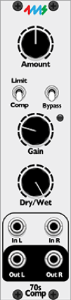 

## 70sComp - Stereo Optical Compressor 

A vintage-style stereo compressor/limiter modeled after optical compressors such as the LA-2A.

- **Peak Reduction**: Sets how aggressively the compressor reduces peaks (threshold).  
  Range: **0 dB to 40 dB** of possible gain reduction.

- **Comp/Limit (switch)**: Selects compression ratio.  
   **Compressor** = 3:1 ratio  
   **Limiter** = 10:1 ratio

- **Gain**: Adds makeup gain after compression to bring signal back up.  
  Range: **0 dB to 40 dB**

- **Dry/Wet**: Mixes between original (dry) and processed (wet) signal. This allows for parallel compression.  
  Range: **0% dry to 100% wet**

- **Bypass (switch)**: Turns compression on or off.  
  • **Off** = signal is compressed  
  • **On** = signal bypasses compression

---
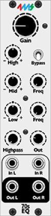 

## 70sEQ - Stereo EQ 

A classic analog-style 3-band stereo equalizer modeled after the Neve 1073.

- **Input Gain**: Boosts incoming signal before EQ stage.  
  Range: **1x to 5x** gain

- **High Shelf Gain**: Boost or cut the high frequencies at a fixed band of 10 kHz.  
  Range: **–15 dB to +15 dB**

- **Mid Gain**: Boost or cut the selected mid frequency band.  
  Range: **–15 dB to +15 dB**

- **Mid Frequency Selector**: Chooses the center frequency for mid EQ.  
  Values: **360 Hz, 700 Hz, 1.6 kHz, 3.2 kHz, 4.8 kHz, 7.2 kHz**

- **Low Shelf Gain**: Boost or cut low frequencies at selected shelf point.  
  Range: **–15 dB to +15 dB**

- **Low Frequency Selector**: Chooses the cutoff frequency for the low shelf.  
  Values: **35 Hz, 60 Hz, 110 Hz, 220 Hz**

- **Highpass Filter Frequency**: Applies a 3-stage highpass filter to remove sub-bass.  
  Values: **50 Hz, 80 Hz, 160 Hz, 300 Hz**

- **Output Level**: Controls post-EQ output amplitude.  
  Range: **0x to 1x**

- **Bypass (switch)**: Turns off all EQ filters.  
  • **Off** = EQ is active  
  • **On** = signal bypasses EQ section

---
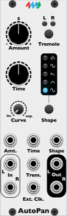 

## AutoPan - Stereo Auto-Panner and Tremolo

A stereo auto-panner that moves your sound back and forth between the left and right outputs using a built-in LFO. With the push of a button it becomes a tremolo instead, pulsing the volume of both sides together. The LFO has five shapes and can sync to an external clock.

- **Amount**: Sets how strongly the sound is panned (or pulsed in tremolo mode).  
  Range: **-100 % to +100 %**, with no effect at the center.  
  Turning it negative flips the direction, so the left and right sides swap.

- **Time**: Sets the speed of the LFO.  
  Range: **0.1 Hz to 60 Hz**  
  When **Ext. Clock** is patched, this knob picks a division or multiplication of the clock instead:  
  **/32, /16, /8, /7, /6, /5, /4, /3, /2, =, x2, x3, x4, x5, x6, x7, x8, x12, x16**

- **Shape (button)**: Steps through the LFO shapes: **Sine, Triangle, Saw, Square, Random**. The lit LED shows which shape is selected. Random jumps to a new level twice per cycle.

- **Curve**: Changes how the volume responds to the LFO, from smooth (**lin.**) to choppy (**exp.**). Turning it toward exp. makes the sound cut out harder and stay quiet longer on each swing.

- **Tremolo (button)**: Switches between auto-pan and tremolo.

- **L / R LEDs**: Show where the sound is at any moment. In auto-pan mode they light **blue** (or **red** when Amount is negative). In tremolo mode they light **green** (or **yellow** when Amount is negative).

- **Amt. CV (input)**: Modulates Amount by control voltage.

- **Time CV (input)**: Modulates the LFO speed by control voltage. When Ext. Clock is patched, it moves through the division and multiplication settings instead.

- **Shape CV (input)**: Moves through the five LFO shapes by control voltage, starting from the shape selected with the button.

- **Trem. CV (input)**: A trigger here switches between auto-pan and tremolo, just like the button.

- **Ext. Clk. (input)**: Patch a clock here to sync the LFO to your tempo.

- **In L / R (inputs)**: Stereo inputs. If only the left input is patched, it is used for both sides.

- **Out L / R (outputs)**: Stereo outputs.

**On MetaModule:**
- The **Time** knob always shows its value in Hz, even when Ext. Clock is patched and the knob is picking a division or multiplication.

---
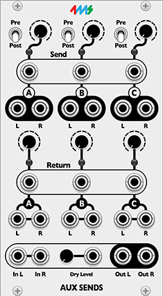 

# AuxSends - Send/Return Mixer 

Three stereo auxiliary send/return pairs with pre/post fader selection and CV control.

- **Send A, B, C (knobs + CV inputs)**  
  Controls the amount of signal sent to each aux send pair. 

- **Pre/Post A, B, C (switches)**  
  Selects whether the send taps the signal before or after dry level attenuation:  
  **Post fader** = send follows dry signal level  
  **Pre fader** = send taps raw input signal before "Dry Level" attenuation

- **Return A, B, C (knobs + CV inputs)**  
  Controls the level of the returned signal from each auxiliary return channel, expressed as a percentage of the return input signal.

- **Dry Level (knob + CV input)**  
  Controls the level of the dry (unprocessed) input signal in the final output mix.

- **Send Outputs (Stereo jacks A, B, C)**  
  Outputs the processed send signals for routing to external effects or other modules.

- **Return Inputs (Stereo jacks A, B, C)**  
  Inputs for receiving processed return signals from external effects or processors.

- **Audio Inputs (Left & Right)**  
  The main stereo audio input into the module.

- **Audio Outputs (Left & Right)**  
  The mixed output of the dry signal plus all returns combined.
  
---
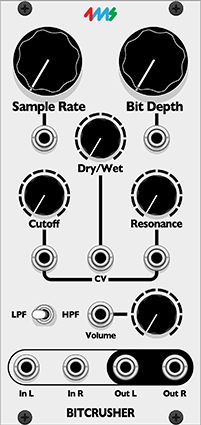 

## Bitcrusher - Stereo Bitcrush & Sample Rate Reduction 

A stereo bitcrusher effect with sample rate reduction, bit depth control, selectable filter, and volume adjustment.

- **Clock Frequency**: Sets the rate at which audio samples are held, reducing sample rate.  
  Range: **15,000 Hz to 20hz**

- **Bit Depth**: Controls the number of bits used to represent each audio sample, affecting crunchiness.  
  Range: **16 bits to 1 bit**

- **Dry/Wet**: Mixes between the clean input signal and the processed bitcrushed output.  

- **Cutoff**: Sets the cutoff frequency of the filter applied after bitcrushing.  
  Range: **20 Hz to 15,000 Hz**

- **Resonance**: Adjusts the emphasis or Q factor of the filter around the cutoff frequency. Higher values = more resonant.  

- **Filter Type (switch)**: Selects the filter mode:  
  **Lowpass** or **Highpass**

- **Volume**: Controls the output amplitude of the processed signal.  

---
 

## Boost - Stereo Gain 

A stereo audio booster with adjustable gain range and output volume control.

- **Gain**: Amplifies the input signal. Clipping occurs at +/-5v

- **Gain Range (switch)**: Selects the gain multiplier applied to the gain parameter:  
  **1×** 
  **5×**  
  **100×**

- **Volume**: Controls the final output level after gain and clipping.  
  Range: **0 % to 100 %**

Red and green LED indicator shows clipping status (red when clipping).

---
 

## Decay - Envelope Generator + VCA 

A decay envelope generator with CV control, and built in VCA for modulating the amplitude of incoming audio. 

- **Decay**: Sets the base length of the decay envelope.  
  Range: **0 % to 100 %**

- **Range (switch)**: Selects the maximum decay time:  
  **Short**: 30 ms  
  **Med**: 200 ms  
  **Long**: 5000 ms

- **Decay CV (input)**: Modulates decay time by control voltage.  
- **Trig (input)**: Triggers the decay envelope on rising edge.  
- **Audio (input)**: Audio signal to be amplitude-modulated by the envelope.

- **Decay (output)**: Outputs the decay envelope signal.  
- **Audio (output)**: Outputs the input audio modulated by the decay envelope.

---
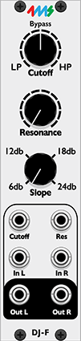 

## DJFilter - Stereo Lowpass/Highpass combo filter

A stereo multimode filter based on the filter from Pioneer DJ mixers. The filter has adjustable cutoff, resonance, and selectable slope. The filter sweeps continuously from lowpass to highpass with bypass in the middle (no filtering). 

- **Cutoff**: Controls the filter cutoff frequency with a unique morphing range:  
  • Lowpass: from 20 Hz to 7000 Hz  
  • Bypass zone at midpoint  
  • Highpass: from 300 Hz to 7000 Hz  
  Default position is bypass.

- **Resonance**: Adjusts the filter resonance (Q factor).  
  Range: **0 % to 100 %**

- **Slope (switch)**: Selects the filter slope:  
  **6 dB/oct**  
  **12 dB/oct**  
  **18 dB/oct**  
  **24 dB/oct**

- **Cutoff CV (input)**: Modulates cutoff frequency by control voltage.

- **Resonance CV (input)**: Modulates resonance by control voltage.

- **Left and Right (inputs)**: Audio inputs for stereo processing. If the right input is not connected, the left input is used for both channels.

- **Left and Right (outputs)**: Filtered stereo audio outputs.

The filter uses multiple stages of state variable filters to achieve the selected slope and offers a smooth morph between lowpass, bypass, and highpass modes based on cutoff knob position.

---
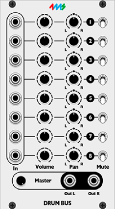 

# DrumBus – 8 channel mono mixer with pan, mute, and master volume

Use this mixer as a submix for drum modules or any mono signals that you wish to convert to a stereo bus. 

### Volume  
Volume per channel.

### Pan  
Pan per channel.

### Mute
Mute per channel.

### Master Volume
Volume of total mix. Output is clamped to 20vpp. 
---

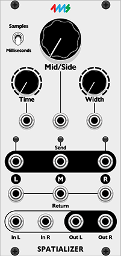 

# Spatializer – Stereo Delay-Based Width and Mid/Side Processor

**Spatializer** is a stereo audio processor that applies short delay-based widening and mid/side blending to incoming signals. It features internal delay buffers, width control, and flexible CV modulation. Designed for insert-style use with send/return capabilities.

A signal is sent to two delay lines of equal time to both left and right channels. The right channel is flipped 180 degrees out of phase. The original mono signal is considered the "mid" and is blended with these two delayed signals. 

- Delay time is selectable in milliseconds or samples.
- Stereo widening and mid/side mixing are adjustable via knobs or CV.
- Includes send/return jacks for external FX routing.

### **Range (Switch)**  
Selects time unit for delay.  
**Options:**  
- Milliseconds (1 ms to 30 ms)  
- Samples (1 to 50 samples)  
**Default:** Milliseconds

### **Time**  
Sets the delay length.  
**Range (ms):** 1 → 30  
**Range (samples):** 1 → 50  
**CV Input:** Time CV

### **Width**  
Controls stereo width.  
**Range:** 0% (mono) → 100% (wide)  
**CV Input:** Width CV

### **Mid/Side**  
Crossfades between mid and side components.  
**Range:** 0% (all mid) → 100% (all side)  
**CV Input:** Mid/Side CV

### Inputs
- **Left** – Main left input (mono if Right is unconnected)
- **Right** – Main right input (optional)
- **Return L / R** – Optional returns for wet signals
- **Return Mid** – Optional return for mid signal

### Outputs
- **Send L / R** – Send left and right wet signals
- **Send Mid** – Mid signal (dry sum) for FX processing
- **Out L / R** – Final processed stereo output

## Notes

- **Stereo / Mono Detection**: If Right input is unconnected, module processes in mono and auto-generates stereo output.  
- **Send / Return Use**: Send outputs can be routed to external FX, then reintroduced via Return inputs. If Returns are unused, internal wet signal is used.  
- **Smoothing**: Time control includes internal slew for smooth transitions.  
- **Width & Panning**: Width control adjusts stereo image width and dry/wet distribution.  
- **Mid/Side Blending**: Allows creative tonal shaping by balancing mono vs stereo components.

---

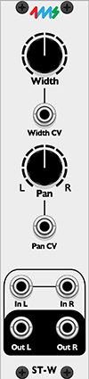 

# StereoWidth – Width and Pan Processor 

### **StereoWidth** 
adjusts how wide your stereo signal sounds and lets you pan it left or right. You can also control these settings with CV inputs. When stereo width is greater than 50%, the left and right channels are subtracted from one another creating a differential pair. At 100% the signal is fully differential. This creates the perception that the stereo field is even wider than the original signal. 

### **Width**  
Changes how wide the stereo image is. If the width knob is greater than 50%, the left and right channels are subtracted from one another creating a differential pair. A greater differential is percieved as an even wider stereo image than the original signal. If the width knob is less than 50% it makes a stereo signal more mono. 
- 0% = mono  
- 100% = normal stereo  
- Up to 200% = extra wide  

### **Pan**  
Moves the stereo balance left or right.  
- -50% = left  
- 0% = center
- +50% = right 

---
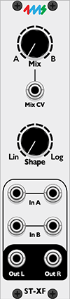 

# StereoCrossfader – Stereo Crossfader with Shape Control

Smoothly blends between two stereo input pairs (A and B) and lets you adjust the curve of the crossfade for different mixing feels and weight. A logarithmic curve has a lower degree of change over a wider field and has a faster change closer to the center point of the fade. 

### Mix  
Controls how much signal comes from Input A vs. Input B.  
- 0% = full Input A  
- 100% = full Input B  
- 50% = equal blend of A and B  

### Shape  
Adjusts the curve of the crossfade:  
- 0% = linear fade (straight mix)  
- 100% = curved fade (logarithmic style)  
- Allows smoother or sharper transitions between A and B.

---
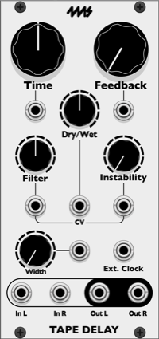 

## TapeDelay - Stereo Tape-Style Delay

A delay inspired by old analog tape echoes. When you change the delay time, it bends in pitch and glides to the new time, like a tape machine speeding up or slowing down, instead of jumping. The repeats get a little darker and dirtier each time they come around, and if you push the feedback up they'll saturate and grow into the classic runaway tape echo sound. It also syncs to an external clock.

Like a real tape echo, there's always a faint bit of tape hiss on the delayed signal.

- **Time**: Sets how long the delay is, from **20 ms to 2 seconds**.  
  When **Ext. Clock** is patched, this knob picks a note value instead (see Ext. Clock below).

- **Feedback**: Sets how many times the echoes repeat. Low settings give you a few quick repeats, and higher settings let them keep going for a long time.  
  Around **87%** the repeats stop fading away. Past that they start to build on themselves until the tape saturates, so you get that wild, self-oscillating tape echo effect without harsh digital clipping.  
  Each repeat goes back through the filter and the tape saturation, so the echoes keep getting more colored the longer they go on. New sound coming in gets recorded cleanly and doesn't cut off the echoes that are already going.

- **Dry/Wet**: Blends between your original signal and the echoes.

- **Filter**: Shapes the tone of the echoes, using the same lowpass/highpass filter as **DJFilter**.  
  Turn it left to make the echoes darker (lowpass, **500 Hz to 7000 Hz**), or right to make them thinner and brighter (highpass, **300 Hz to 1000 Hz**). At the center, the filter is off. The center is the default.  
  Every echo goes through the filter, including the very first one.

- **Instability**: Adds the wobble of a worn-out tape machine (wow and flutter). Turn it up for a slow, warbly drift that gets deeper and faster the further you go.  
  Range: **0% to 100%**

- **Width**: Spreads the echoes out in stereo.  
  At **0%**, the echoes come out of both speakers equally.  
  At **100%**, they bounce back and forth between the left and right speakers (ping-pong), starting on the left.  
  Anywhere in between gives you a partial spread.  
  The delay itself is mono, so your left and right inputs are blended together before they go into the delay. Your dry signal stays in stereo.

- **Ext. Clock (input)**: Patch in a clock to sync the delay to your tempo. Each clock pulse counts as a quarter note, and the **Time** knob picks the note value. From shortest to longest:  
  **1/16, 1/16T, 1/16D, 1/8, 1/8T, 1/8D, 1/4, 1/4T, 1/4D, 1/2, 1/2T, 1/2D, 1/1, 1/1T, 1/1D**  
  (T = triplet, D = dotted)  
  When it's synced, the delay jumps straight to the new time instead of gliding, so it stays locked to the beat.  
  The longest delay possible is about **4 seconds** (or about **2 seconds** if your system runs at 96 kHz). At slow tempos, the longest note values will be cut short to fit.

- **Audio Left / Right (inputs)**: Stereo inputs. If you only patch one side, that signal is used for both sides. Unlike the other Producer Pack modules, this works with either jack.

- **Audio Left / Right (outputs)**: Stereo outputs.

**On MetaModule:**
- The **Time** knob always shows its value in milliseconds, even when Ext. Clock is patched and the knob is picking note values.
- The **Filter** knob reads from **-100%** (darkest) to **+100%** (brightest), with **0%** meaning the filter is off.
